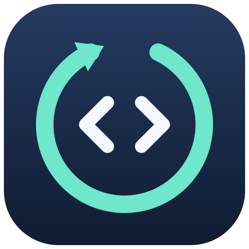
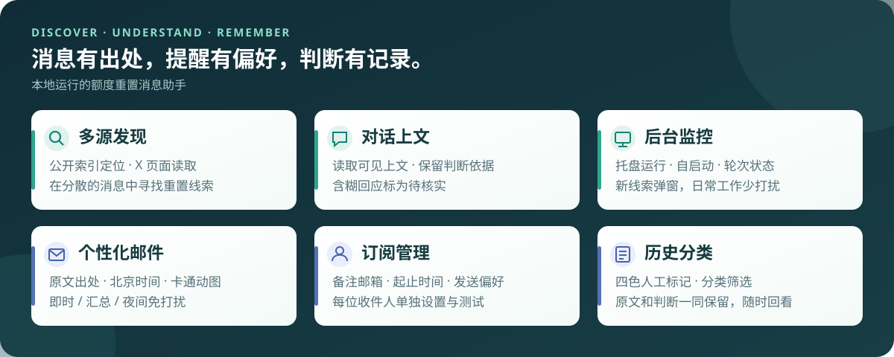
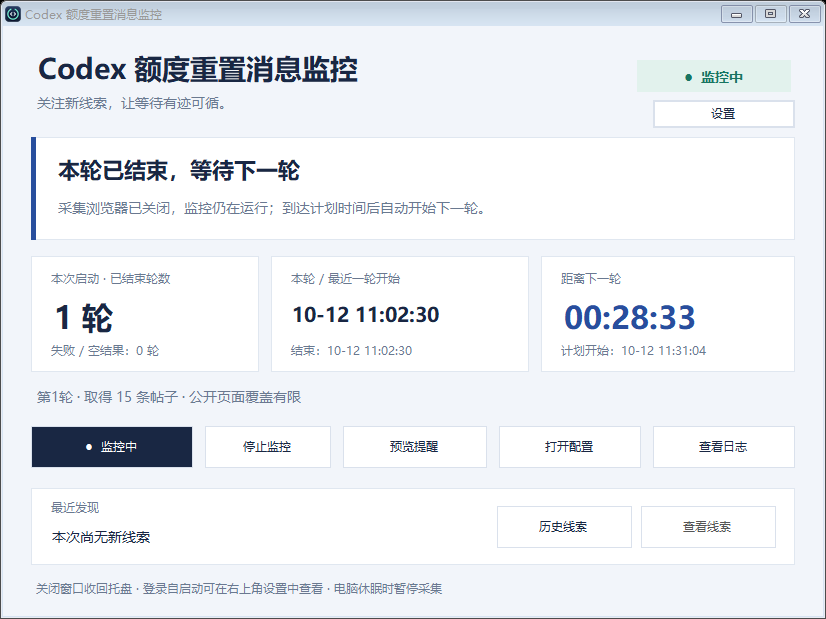
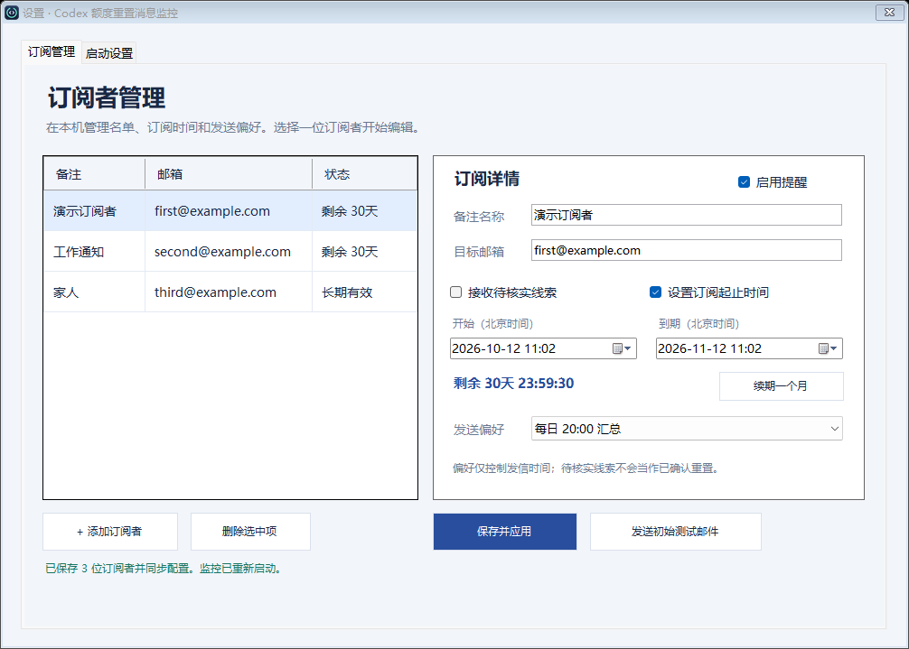
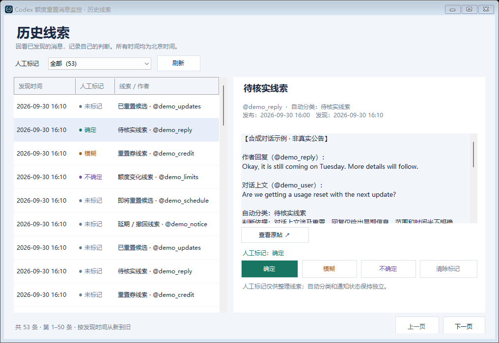
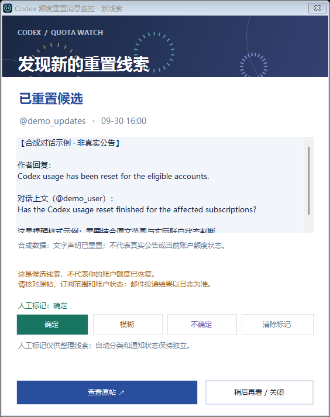
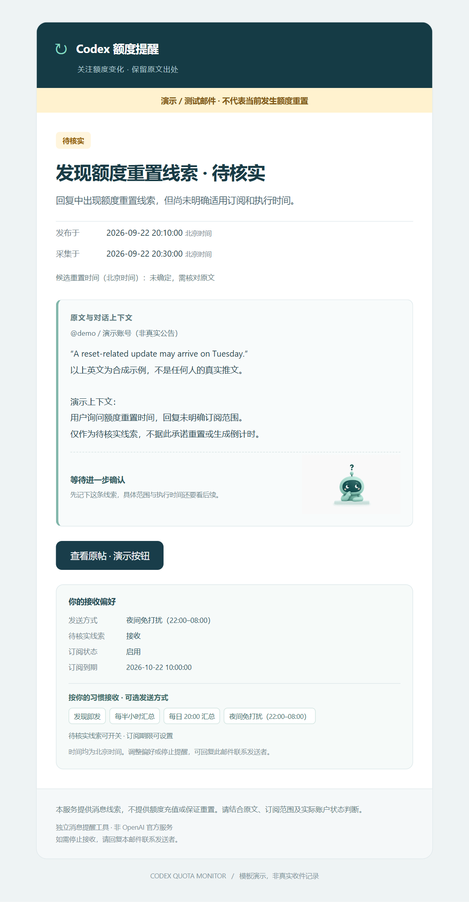
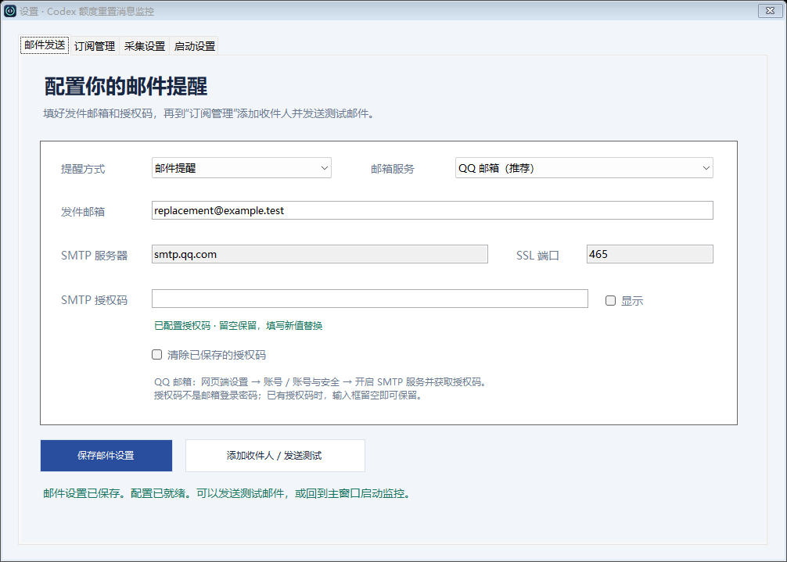
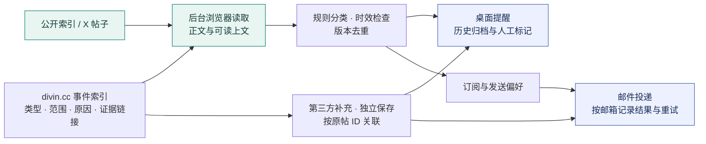
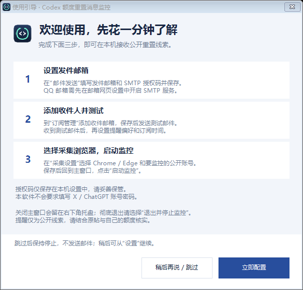

<p align="center">
  
</p>

<h1 align="center">Codex 额度重置消息监控</h1>

<p align="center">把分散的重置消息，整理成可追溯的线索、桌面提醒与邮件。</p>

<p align="center"><strong>Windows 后台运行</strong> · 默认每 30 分钟检查 · 无需 X API Key</p>

<p align="center">
  <a href="https://github.com/AntoSmith/Tools-CodexQuotaResetMonitor/releases/download/v0.2.3/CodexQuotaMonitor-Setup-v0.2.3-windows-x64.exe">下载 Windows 安装版 EXE</a> ·
  <a href="https://github.com/AntoSmith/Tools-CodexQuotaResetMonitor/releases/latest">便携版与版本说明</a> ·
  <a href="#界面一览">界面一览</a> · <a href="#快速开始">快速开始</a> ·
  <a href="docs/USAGE.md">使用说明</a> · <a href="config.browser.example.toml">配置模板</a>
</p>



<details>
<summary><strong>功能详情 · 重置预告、已重置候选、重置券、额度变化、延期撤回与待核实线索</strong></summary>

| 功能 | 使用体验 |
| --- | --- |
| 🔎 多源发现 | 公开索引定位 Tibo 帖子与回复，后台浏览器读取 X；支持配置其他公开账号。 |
| 🧾 事件补充 | divin.cc 的事件类型、覆盖范围、重置原因与参考链接分别展示，可回看来源判断依据。 |
| 💬 上文辅助判断 | 结合可读取的对话上文筛选重置线索，含糊回应保留“待核实”说明。 |
| 🖥️ 桌面状态与提醒 | 托盘、自启动、轮次、采集结果与倒计时；新线索弹窗可直接人工标记。 |
| 🎨 历史分类 | 🟢确定 / 🟠模糊 / 🟣不确定 / ⚪未标记，保存原文与版本，支持筛选、改标和清除。 |
| 👥 本地订阅管理 | 中文备注、多邮箱、启停、起止时间、续期、待核实开关、单人测试邮件。 |
| ⚙️ 界面配置 | 发件邮箱、授权码、QQ / 自定义 SMTP、Chrome / Edge 和监控账号，都在设置中完成。 |
| ⬆️ 检查更新 | 设置或托盘检查 GitHub 新版本，选择下载升级；保留本机配置、邮箱名单和历史数据。 |
| 👋 开始使用 | 单个 Setup.exe 安装，自动创建应用入口；首次引导可跳过，随时从设置再次查看。 |
| 📬 个性化邮件 | 原文与来源、北京时间、接收偏好、卡通动图；支持即时、半小时汇总、每日汇总及夜间免打扰。 |

</details>

## 界面一览

<table>
  <tr>
    <td width="50%"><strong>监控面板</strong><br>轮次、采集状态、下一轮倒计时<br><br></td>
    <td width="50%"><strong>订阅管理</strong><br>每位收件人都有自己的期限和发送偏好<br><br></td>
  </tr>
  <tr>
    <td><strong>历史线索</strong><br>按颜色分类，回看原文与上下文<br><br></td>
    <td><strong>新线索提醒</strong><br>原文醒目，第三方摘要分层，长依据可展开<br><br></td>
  </tr>
</table>

<details>
  <summary><strong>📨 展开查看邮件样式与卡通动图</strong></summary>
  <p>邮件包含来源、上下文和个人接收偏好；支持 HTML 与纯文本。</p>
  <p align="center"> </p>
  <p align="center"></p>
</details>

*截图均使用合成线索或虚构联系人；人工标记用于历史整理，独立于自动分类和邮件规则。*

<details>
  <summary><strong>⚙️ 展开查看邮件配置界面 · 无需编辑配置文件</strong></summary>
  <p>填写发件邮箱与授权码，保存后添加收件人并发送测试邮件；监控账号和浏览器也在设置中选择。</p>
  
</details>

## 一条线索的旅程



来源：[codex-reset.com](https://codex-reset.com/) 公开索引及 X 页面。第三方索引用于发现和定位；正文与可读取的上文由浏览器读取，缺失或未核实的关系保留说明。

## 快速开始

### 推荐：下载安装版

**Windows 10/11 x64，无需自行安装 Python、Node.js 或 npm。**

1. 下载 [Setup.exe 安装包](https://github.com/AntoSmith/Tools-CodexQuotaResetMonitor/releases/download/v0.2.3/CodexQuotaMonitor-Setup-v0.2.3-windows-x64.exe)，双击按中文向导安装。
2. 首次打开，选择 **立即配置**；也可选 **稍后再说 / 跳过**，之后从 **设置 → 使用指南** 继续。
3. 在 **邮件发送** 填写发件邮箱与 SMTP 授权码；在 **订阅管理** 添加收件人、保存并发送测试邮件。
4. 在 **采集设置** 选择浏览器和监控账号；保存后返回主窗口点击 **启动监控**。

<p align="center"></p>

安装版为当前 Windows 用户安装，提供开始菜单入口与可选桌面快捷方式。跳过引导保持停止，设置完成后再手动启动。日常使用无需编辑配置文件；应用升级和卸载均保留本机配置、收件名单、历史与浏览器资料。

后续在 **设置 → 软件更新** 或托盘的 **检查更新** 中升级。下载并校验后替换程序文件，保留本机配置、收件人、订阅偏好及历史；升级前请保存设置。安装时短暂退出，完成后自动重新打开，并保留监控启停状态。

也可下载 `windows-x64.zip` 便携版，完整解压后运行 `CodexQuotaMonitor.exe`，保留整个文件夹。两个版本均包含运行依赖，使用本机已有的 Chrome 或 Edge；下载包只带模板，运行产生的配置、名单与数据保存在使用者本机。

<details>
<summary><strong>开发者：从源码构建</strong></summary>

**准备环境：** Windows · Python 3.11+ · Node.js/npm · Chrome 或 Edge

```powershell
git clone https://github.com/AntoSmith/Tools-CodexQuotaResetMonitor.git
cd Tools-CodexQuotaResetMonitor
Copy-Item config.browser.example.toml config.browser.local.toml
npm install
powershell -NoProfile -ExecutionPolicy Bypass -File scripts/build-desktop.ps1
```

1. 双击 `CodexQuotaMonitor.exe`，在 **设置 → 邮件发送 / 采集设置** 中配置邮件与监控账号。
2. 在 **订阅管理** 中添加收件人及偏好；在 **启动设置** 中选择自启动。
3. 在 **历史线索** 中回看记录；关闭主窗口收回托盘，托盘“退出”停止监控。

便携包构建：`python scripts/build-portable.py --version 0.2.3`。再用官方 Inno Setup 编译器运行 `python scripts/build-installer.py --archive dist/CodexQuotaMonitor-v0.2.3-windows-x64.zip --iscc <ISCC.exe路径>` 生成安装 EXE。下载来源、校验与许可证见包内 `runtime-provenance.json` 和 `THIRD_PARTY_NOTICES.txt`。

</details>

[首次使用与 X 登录](docs/USAGE.md#首次使用) · [订阅管理](docs/USAGE.md#本地订阅管理) · [邮件测试](docs/USAGE.md#测试选中的收件邮箱) · [历史标记](docs/USAGE.md#历史线索与人工标记)

## 使用与隐私

| 你需要知道 | 说明 |
| --- | --- |
| 消息的含义 | 非官方候选线索，需结合原帖和账户状态判断；不提供充值或代重置。 |
| 运行条件 | 本机需联网且保持唤醒；页面限制和来源延迟会影响覆盖与及时性。 |
| 程序依赖 | 下载版自带 Python、Node.js 与 Playwright；源码版需准备依赖。两者都需保留完整文件夹。 |
| 私人数据 | 仓库只含配置模板；个人配置、收件名单、数据库、日志及浏览器会话留在本地。 |

[完整使用与排查](docs/USAGE.md) · [发布与隐私检查](docs/PUBLISH.md)
